# Tokenomos

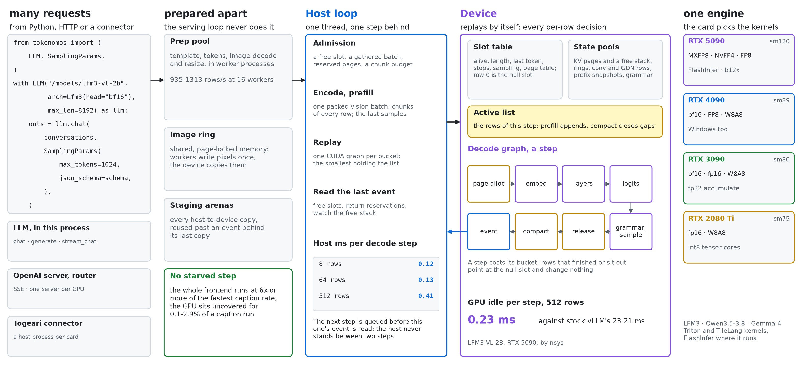

Local inference for small VLMs (LFM3, Qwen3.5 – 3.8, Gemma 4) where the GPU is the only bottleneck:
the host's work per decode step stays near flat as sequences are added, and the frontend runs at
six times the fastest caption rate or more. The name is token + nomos (law), after metronome
(metron + nomos): one token per beat.

A serving engine usually spends each step on the host: it schedules rows, reads their tokens,
checks for stops and writes the next step's inputs. That cost grows with the rows, and while it
runs the GPU waits. Tokenomos moves all of it onto the device. Page allocation, sampling, grammar,
the finish test and compaction of the row list are kernels inside one CUDA graph. The host thread
queues the next step, then reads the event of the step before, so it is always one step behind
and the GPU always has work.

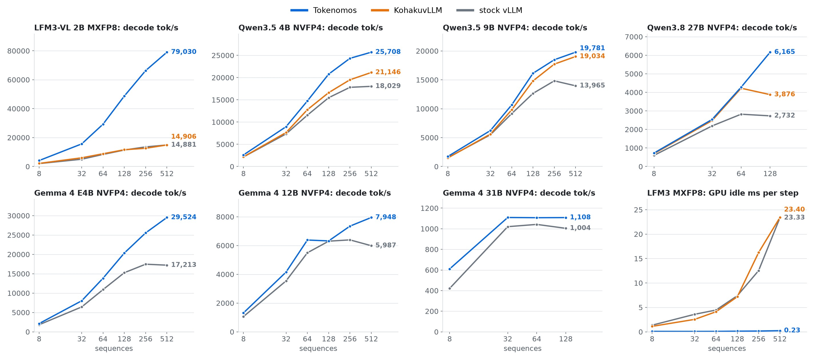

**Contents:** [Highlights](#highlights) · [Install](#install) · [Quick start](#quick-start) ·
[How it works](#how-it-works) · [Models and cards](#models-and-cards) · [Knobs](#knobs) ·
[Measured](#measured) · [Repository layout](#repository-layout) ·
[Documentation](#documentation) · [Checks](#checks)

## Highlights

- **2.2–4.8x stock vLLM on captions, on the same RTX 5090, on the same call path.** In process
  LFM3-VL 2B 130 images/s against 47, Qwen3.5 4B 65 against 24, Qwen3.8 27B 18 against 4; over HTTP
  135 against 42, 62 against 22, 19 against 4. Gemma 4 12B and 31B, where decode binds the card, sit
  at 0.95–1.1x stock ([measured](#measured)).
- **The GPU does not wait.** LFM3 MXFP8 at 512 sequences: GPU idle 0.23 ms per step against stock
  vLLM's 23.33, for 79,030 decode tok/s against 14,881. Caption runs reach 89–98% of the sum of each
  stage's own ceiling on the card.
- **The frontend is not a limit.** Prep pool 935–1313 rows/s at 16 workers, 1389 HTTP requests/s,
  no starved step in 14 runs. Over HTTP a caption rate stays within 6% of in-process on every model.
- **The whole GBC graph.** Every model through a Togeari connector, SAM 3 and EmbeddingGemma on the
  same card, no failed image: LFM3 4.72 images/s and Qwen3.5 4B 2.65 on one RTX 5090.
- **One engine from an RTX 5090 to an RTX 2080 Ti.** MXFP8 and NVFP4 where the card has them,
  INT8 W8A8 with a ConvRot rotation knob on tensor cores back to Turing, fp16 accumulating in
  float32 at 2.5–5x cuBLAS fp32's rate on a 3090.
- **Windows without FlashInfer.** The same paths through `triton-windows` and TileLang, with a GDN
  prefill of our own: an RTX 4090 in 19 GiB captions LFM3-VL 2B at 79 images/s on FP8 and Qwen3.5
  4B at 27 ([measured](#windows-on-an-rtx-4090)).
- **In Python and over HTTP.** `LLM` in your process, an OpenAI server with streaming, a router over
  several GPUs. JSON-schema replies run on the device through a Rust-built transition table.

## Install

```
git clone https://github.com/KohakuBlueleaf/Tokenomos && cd Tokenomos
uv venv -p 3.12
uv pip install -e ".[gpu,tensorcore,dev]"     # add torch from the index matching your driver
```

| Extra | Adds |
|---|---|
| `gpu` | FlashInfer: MXFP8 and NVFP4 GEMMs, the GDN prefill (Linux, sm90 and up) |
| `tensorcore` | TileLang 0.1.15: W8A8 and the fp16 route (needs nvcc and a host compiler) |
| `dev` | pytest, ruff, black, transformers for the reference models in the tests |

Building needs a Rust toolchain for the extension `tokenomos._rs`. `maturin develop --release`
rebuilds it. On Windows TileLang compiles through nvcc and Visual Studio's `cl.exe`, which it finds
on its own; Tokenomos keeps it off `clang-cl`, which nvcc refuses.

## Quick start

`models.configure` reads the checkpoint's architecture and builds its declaration:

```python
from tokenomos import LLM, SamplingParams, models

path = "/models/lfm3-vl-2b-mxfp8"
arch = models.configure(path, head="mxfp8")
with LLM(path, arch=arch, max_len=8192) as llm:
    outs = llm.chat(conversations, SamplingParams(max_tokens=1024), enable_thinking=False)
```

`conversations` is a list of OpenAI-style message lists, images as `image_url` data URLs. Each
`Output` has `text`, `token_ids`, `prompt_tokens` and `finish`. `llm.generate` takes plain prompts.

**A reply held to a JSON schema**, on the device:

```python
schema = {"type": "object", "properties": {"city": {"type": "string"}}, "required": ["city"]}
outs = llm.chat(conversations, SamplingParams(max_tokens=64, json_schema=schema))
```

**Streaming.** `stream_chat` and `stream` yield text deltas, then the `Output`:

```python
for event in llm.stream_chat(messages, SamplingParams(max_tokens=256)):
    print(event if isinstance(event, str) else "", end="", flush=True)
```

**An OpenAI server**, and one server per GPU behind one port:

```
python -m tokenomos.api.server --model M --port 8000 --arch-kw '{"head": "mxfp8"}'
python -m tokenomos.api.router --model M --gpus 0,1,2,3 --port 8000 -- --arch-kw '{"head": "mxfp8"}'
```

| Route | Does |
|---|---|
| `POST /v1/chat/completions` | chat; `stream` gives server-sent events, `stream_options.include_usage` a usage event |
| `POST /v1/completions` | a text or token-id prompt |
| `GET /v1/models`, `GET /health` | the served model; liveness |

`response_format` `json_schema` holds a reply to its schema; `chat_template_kwargs` reaches the
template. Stop strings are refused; `stop_token_ids` is served.

**In a GBC machine**, in the card's engine host behind a connector
([KohakuGBC](https://github.com/KohakuBlueleaf/KohakuGBC)):

```python
engines = {"vlm": {"entry": "tokenomos", "model": path, "arch": {"head": "mxfp8"}}}
```

## How it works

| Layer | Package | Holds |
|---|---|---|
| Ways in | `tokenomos.api` | `LLM`, the prep pool and image ring, the chat template, the server and router |
| Engine | `tokenomos.core` | the slot table, one decode graph per bucket, admission, pools, staging, the prefix table, device grammar |
| Models | `tokenomos.models` | what a model declares, the blocks, checkpoint loading, reference forward |
| Kernels | `tokenomos.kernels` | Triton and TileLang kernels: linears, attention, norms, conv, GDN, sampling, grammar, slot bookkeeping |
| Grammar | `tokenomos._rs` (Rust) | JSON-schema matcher, mask store and table entries |

### One beat

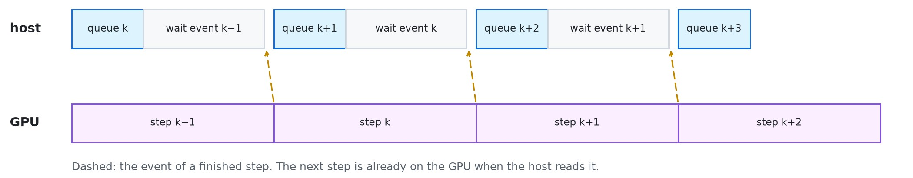

The host queues step *k*, then waits on the event of step *k − 1*, so the GPU never waits on the
host. What the host learns is one step old: a finished row sits idle for a step or two, a small
cost against a stall on every step. Every host-to-device copy goes through pinned staging arenas,
and an arena is reused only past an event behind its last queued copy.

### Slots and buckets

A slot holds one request; slot 0 is the null slot. The active list names the rows of a step. A CUDA
graph has a fixed shape, so the engine captures one graph per bucket (8, 16, 32, 64, 96, 128, 192,
256, 384, 512, up to the slot count, and the slot count) and replays the smallest that holds the
list. A row that finished or sits out points at the null slot and changes nothing. A step costs its
bucket, so live rows, generated tokens per step, are what to watch.

### A request's path

```mermaid
flowchart LR
    req["request"] --> prep["prep pool<br/>template, tokens, pixels"]
    prep --> wait["waiting"]
    wait -->|"free slot, gathered batch,<br/>reserved pages, chunk budget"| enc["encode images<br/>one packed batch"]
    enc --> pre["prefill chunks<br/>the last samples token 1"]
    pre --> act["active list"]
    act --> step["decode graph"]
    step -->|"alive"| act
    step -->|"finished: event"| host["host frees the slot,<br/>returns its pages"]
    host --> out["Output"]
```

A prefill forward stalls every running row, so free slots gather into a batch of `admit_batch`
before one runs. Vision goes through one packed batch per admission. The prefix table shares KV
pages of a common prompt start and snapshots every per-slot state at it.

### Pages without worst cases

A caption asks for 1024 tokens and writes about 100, so a request reserves its prompt and
`reserve_new` tokens rather than its whole `max_tokens`. Rows past that draw on the shared pool:

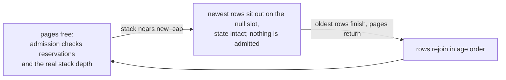

`new_cap` tokens of pages always stay back, so the oldest row can finish and the pool always
drains. Paused rows keep their position and tokens, and their output equals a run with a larger
pool. A request larger than the whole pool is refused at submit.

### Host work on a frame

Everything per-request runs before the loop. Workers render the template, tokenize, decode and
resize images and write pixels into a shared page-locked ring; the serving process does the RoPE
of multimodal prompts at submit and hands the engine a prepared request. The loop itself replays a
graph and reads an event.

## Models and cards

| Model | Declaration | Checkpoints |
|---|---|---|
| LFM3-VL 2B, LFM3 Omni 2B | `tokenomos.models.lfm3.arch.Lfm3` | bf16, MXFP8, compressed-tensors FP8 |
| Qwen3.5 4B, 9B; Qwen3.8 27B | `tokenomos.models.qwen35.arch.Qwen35` | bf16, ModelOpt NVFP4 / FP8 / mixed, compressed-tensors NVFP4 / FP8 |
| Gemma 4 E4B, 12B, 31B | `tokenomos.models.gemma4.arch.Gemma4` | bf16, MXFP8, NVFP4 |

| Card | Platform | Formats | GDN prefill | Suite, 419 tests |
|---|---|---|---|---|
| RTX 5090, sm120 | Linux | bf16, MXFP8, NVFP4, FP8, W8A8 | FlashInfer, `fused` | 419 pass |
| RTX 4090, sm89 | Windows | bf16, FP8, W8A8 | `fused` | 359 pass, 60 skipped |
| RTX 3090, sm86 | Linux | bf16, fp16, `fp32`, W8A8 | `fused` | 322 pass, 97 skipped |
| RTX 2080 Ti, sm75 | Linux | fp16, `fp32`, W8A8 | `fused` | 218 pass, 201 skipped |

Skips are what the card cannot run: MXFP8 and NVFP4 need sm100 (on an RTX 4090 cuBLAS answers
`NOT_SUPPORTED` for MXFP8 and ptxas rejects the NVFP4 kernels), FP8 needs sm89, bf16 needs sm80.

**W8A8.** `models.configure(path, int8=True, rotate=16)` turns the decoder's 16-bit linears into
int8 weights at load, with an activation scale per token and the GEMM on int8 tensor cores with
int32 accumulate. `rotate` applies a regular Hadamard rotation per group of input columns (4, 16,
64, 256; [ConvRot](https://arxiv.org/pdf/2512.03673)), which spreads outlier columns: first-token
agreement with bf16 rises from 0.91 to 0.94–1.00 on LFM3 and 4B.

**Work dtypes.** `models.configure(path, work="fp16")` sets the dtype of weights, activations and
state: `bf16` from sm80 up by default, `fp16` below it, where PTX has no bf16. `fp32` keeps
activations, state and embeddings in float32 with fp16 weights, and a matmul runs fp32 → fp16 with
float32 accumulation → fp32, on `route` `tilelang` or `cublas`. It is a precision knob: fp16 holds
bf16's speed at an eighth of its logit gap to a float32 reference, and `fp32` costs 16–47% of the
rate for up to 3.5x less again. MXFP8, NVFP4 and FP8 run on bf16 only.

## Knobs

`models.configure` takes:

| Knob | Default | |
|---|---|---|
| `head` | `bf16` | the LM head: `bf16` (the checkpoint's), `mxfp8` or `nvfp4`, quantized at load |
| `state_format` | `fp32` | Qwen's GDN state: `fp32`, `bf16`, `int8`, `fp8` |
| `gdn_prefill` | `auto` | Qwen's GDN chunked prefill: `flashinfer` (sm90 and up), `fused` (every card), `fla`; `auto` the first that runs |
| `work` | by card | `bf16`, `fp16`, `fp32` |
| `route` | `cublas` | `fp32`'s matmul: `tilelang`, `cublas` |
| `int8`, `rotate` | off | W8A8 at load, its rotation group |

`LLM` and `Engine` take:

| Knob | Default | |
|---|---|---|
| `slots` | what memory holds, at most 256 | rows at once; a dense sliding-window ring costs a slot `min(window, max_len)` rows, so a lower `max_len` holds more on Gemma 4 |
| `max_len` | 4096 | longest sequence |
| `page` | 32 | tokens per KV page |
| `pages` | free memory | KV pages, after the slot states less `kv_reserve` |
| `kv_reserve` | a third of free memory, at most 5 GiB | kept for vision, prefill and graph buffers |
| `kv_leave` | 0 | bytes left out of all sizing, for other engines on the card |
| `prefill_budget` | a tenth of free memory, at most 8192 tokens | tokens in one prefill forward |
| `prefix_entries` | a quarter of the slots, at most 64 | prompt starts kept; none under 16 slots |
| `admit_batch` | an eighth of the slots | free slots to gather while rows run |
| `reserve_new` | 256 | new tokens a request reserves pages for |
| `new_cap` | 1024 | tokens of pages held back so the oldest row finishes |
| `stream_every` | 4 | steps between new-token reports when a row streams |
| `graphs` | True | False runs the decode step eagerly, on the same kernels |

## Measured

Every number comes from a script in `bench/` whose report lands in `reports/`. Standard kernels
only; vLLM is 0.32.0, stock means no plugin, and
[KohakuvLLM](https://github.com/KohakuBlueleaf/KohakuvLLM) is the plugin. Full tables:
[docs/measurements](docs/measurements).

### Root captions on an RTX 5090

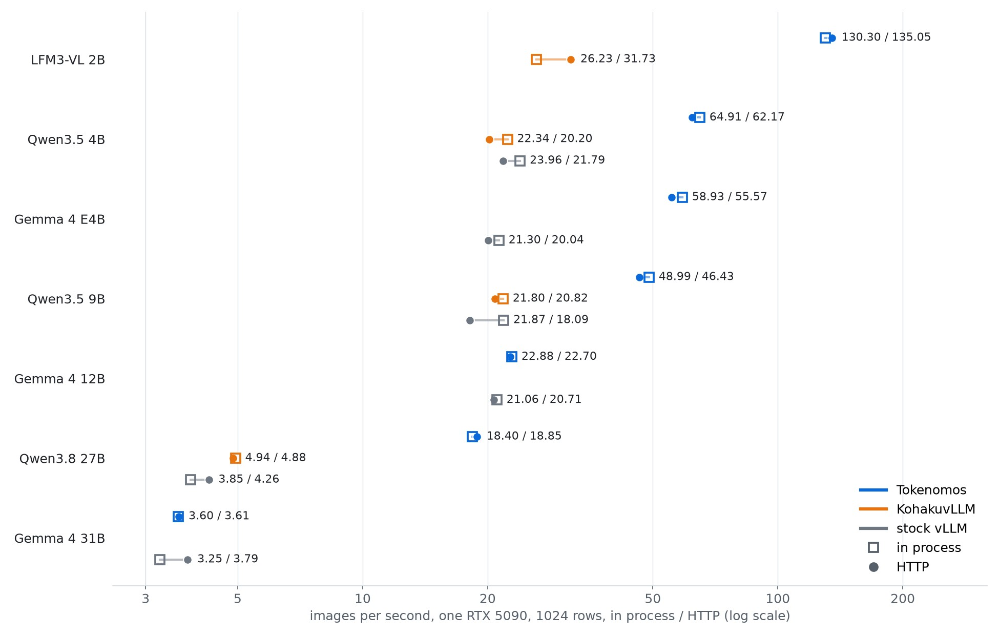

1024 GBC root-caption rows on every engine and call path: greedy, thinking off, `max_tokens` 1024,
`max_len` 4096, images up to 1024² pixels in area, median 0.08 Mpx. Images per second over the whole
batch ([captions](docs/measurements/captions.md)). Each engine's best native setup: KohakuvLLM with
the int8 GDN state, stock vLLM with no plugin and the bf16 GDN state, 256 sequences at 0.90 of the
card.

| Model | Tokenomos in process | Tokenomos HTTP | KohakuvLLM in process | KohakuvLLM HTTP | Stock vLLM in process | Stock vLLM HTTP |
|---|---|---|---|---|---|---|
| LFM3-VL 2B MXFP8 | 130.30 | **135.05** | 8.08 (loops) | 34.37 | 46.89 (FP8) | 42.44 (FP8) |
| Qwen3.5 4B MXFP8 | **64.91** | 62.17 | 22.34 | 20.20 | 23.96 (FP8) | 21.79 (FP8) |
| Gemma 4 E4B NVFP4 | **58.93** | 55.57 | | | 21.30 | 20.04 |
| Qwen3.5 9B NVFP4 | **48.99** | 46.43 | 21.80 | 20.82 | 21.87 | 18.09 |
| Gemma 4 12B NVFP4 | **22.88** | 22.70 | | | 21.06 | 20.71 |
| Qwen3.8 27B NVFP4 | 18.40 | **18.85** | 4.94 | 4.88 | 3.85 | 4.26 |
| Gemma 4 31B NVFP4 | 3.60 | 3.61 | | | 3.25 | **3.79** |

vLLM has no LFM3, so its rows run LFM3's model definition as a registered architecture: every linear,
attention and sampler kernel is vLLM's own, and the conv is ours, since vLLM's kernels stop at width
5. FP8 is stock's best LFM3 checkpoint: MXFP8 gives 27.75 / 32.07, NVFP4 36.98, bf16 33.86 in
process. KohakuvLLM in process loops on 1014 of its replies, and that row is not a throughput.

Gemma 4 runs on stock vLLM alone. 31B over HTTP is the one cell stock leads, by 5%: a sliding ring
costs 800 MiB a slot, so Tokenomos holds nine slots, and decode is two thirds of its run. 12B and
31B set `kv_reserve` to 4 and 2 GiB so the rings get the memory.

### Decode and prefill on an RTX 5090

Decode is the figure at the top of this page. Prefill per model, and a decode step's time on LFM3-VL
2B MXFP8 by nsys. LFM3 in both figures runs MXFP8 on every engine, vLLM with its engine in one
process.

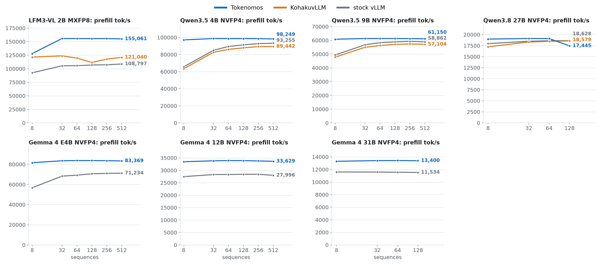

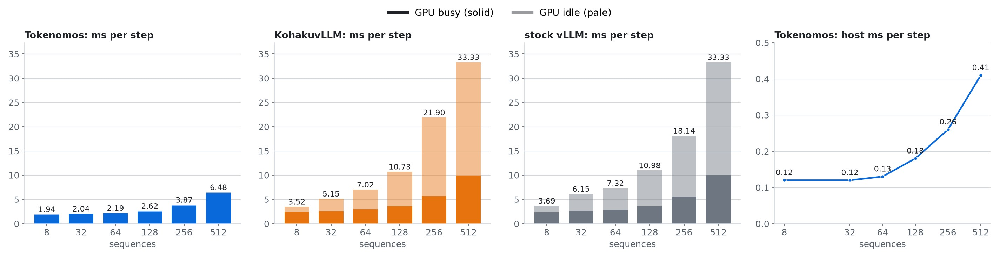

Random prompts, greedy, EOS ignored. Decode: S × 64-token prompts, 512 generated. Prefill: S ×
2048-token prompts, 1 generated. LFM3-VL 2B, Tokenomos on MXFP8, stock vLLM on FP8 with LFM3's model
definition registered, one GPU; both rates over the whole call, stock in its normal multiprocess
engine. Step ms is wall / GPU busy / GPU idle by nsys, stock's with the engine in one process, where
it decodes 15,070 tok/s at 512 ([LFM3](docs/measurements/lfm3-vl-2b.md)):

| Seqs | Prefill tok/s stock | Prefill tok/s Tokenomos | Decode tok/s stock | Decode tok/s Tokenomos | Step ms stock | Step ms Tokenomos | Host ms Tokenomos |
|---|---|---|---|---|---|---|---|
| 8 | 111,850 | 127,946 | 3,194 | 4,129 | 3.58 / 2.31 / 1.27 | 1.94 / 1.85 / 0.09 | 0.12 |
| 64 | 117,967 | 155,772 | 11,198 | 29,257 | 6.96 / 2.93 / 4.03 | 2.19 / 2.10 / 0.09 | 0.13 |
| 256 | 124,554 | 155,660 | 15,813 | 66,298 | 18.50 / 6.12 / 12.38 | 3.86 / 3.71 / 0.16 | 0.26 |
| 512 | 120,229 | 155,061 | 16,557 | 79,030 | 33.98 / 10.77 / 23.21 | 6.48 / 6.25 / 0.23 | 0.41 |

Peak decode and best prefill on the others; the vLLM columns are KohakuvLLM with the int8 GDN state
on Qwen, stock on Gemma 4 ([Qwen](docs/measurements/qwen35.md),
[Gemma 4](docs/measurements/gemma4.md)):

| Model | Decode tok/s Tokenomos | Decode tok/s vLLM | Prefill tok/s Tokenomos | Prefill tok/s vLLM |
|---|---|---|---|---|
| Qwen3.5 4B NVFP4, int8 state | 25,884 | 21,146 | 102,043 | 89,442 |
| Qwen3.5 9B NVFP4, int8 state | 18,825 | 19,034 | 62,396 | 57,390 |
| Qwen3.8 27B NVFP4, int8 state | 4,337 | 4,223 | 18,871 | 18,579 |
| Gemma 4 E4B NVFP4 | 29,524 | 17,462 | 83,750 | 71,234 |
| Gemma 4 12B NVFP4 | 7,948 | 6,392 | 33,931 | 28,410 |
| Gemma 4 31B NVFP4 | 1,109 | 1,042 | 13,425 | 11,605 |

### Where a caption run spends the card

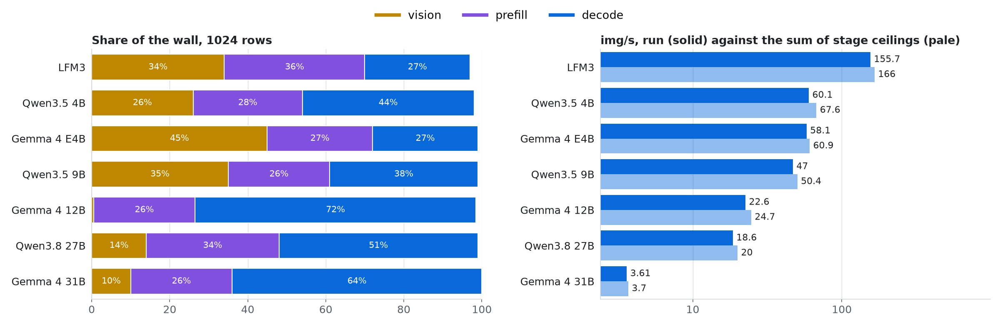

Seconds on the card over 1024 rows, shares of the wall, and the run against each stage's own ceiling
([bottlenecks](docs/measurements/bottlenecks.md)):

| Model | Vision | Prefill | Decode | Largest | Measured / ceiling img/s |
|---|---|---|---|---|---|
| LFM3 | 34% | 36% | 27% | prefill, vision | 155.7 / 166 |
| Qwen3.5 4B | 26% | 28% | 44% | decode | 60.1 / 67.6 |
| Gemma 4 E4B | 45% | 27% | 27% | vision | 58.1 / 60.9 |
| Qwen3.5 9B | 35% | 26% | 38% | decode, vision | 47.0 / 50.4 |
| Gemma 4 12B | 0.5% | 26% | 72% | decode | 22.6 / 24.7 |
| Qwen3.8 27B | 14% | 34% | 51% | decode | 18.6 / 20.0 |
| Gemma 4 31B | 10% | 26% | 64% | decode | 3.61 / 3.70 |

The host's share is the uncovered time: 0.1–2.9% of the wall. Frontend CPU runs beside the card in
workers. One runaway reply, alone in the smallest bucket until `max_tokens`, costs a run the
difference between the 155.7 here and the 130.30 above.

### The full GBC graph

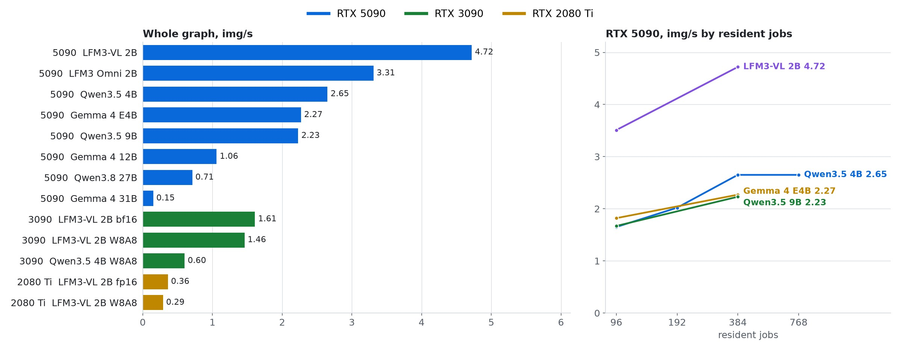

`mid.py` and `sam3.py` in [KohakuGBC](https://github.com/KohakuBlueleaf/KohakuGBC), the VLM in an
engine host behind a connector, SAM 3 and EmbeddingGemma on the same card. COCO val2017: long side
640 px at most, median 0.27 Mpx.

| Card | VLM | Images | Resident jobs | Images ok | img/s |
|---|---|---|---|---|---|
| RTX 5090 | LFM3-VL 2B | 1200 | 384 | 1200 / 1200 | 4.72 |
| RTX 5090 | LFM3 Omni 2B | 300 | 384 | 300 / 300 | 3.31 |
| RTX 5090 | Qwen3.5 4B | 1200 | 384 | 1200 / 1200 | 2.65 |
| RTX 5090 | Gemma 4 E4B | 1200 | 384 | 1200 / 1200 | 2.27 |
| RTX 5090 | Qwen3.5 9B | 1200 | 384 | 1200 / 1200 | 2.23 |
| RTX 5090 | Gemma 4 12B | 300 | 384 | 300 / 300 | 1.06 |
| RTX 5090 | Qwen3.8 27B | 300 | 384 | 300 / 300 | 0.71 |
| RTX 5090 | Gemma 4 31B | 300 | 96 | 300 / 300 | 0.15 |
| RTX 3090 | LFM3-VL 2B bf16 | 1200 | 384 | 1200 / 1200 | 1.61 |
| RTX 3090 | LFM3-VL 2B W8A8, rotate 16 | 1200 | 384 | 1200 / 1200 | 1.46 |
| RTX 3090 | Qwen3.5 4B W8A8, rotate 16 | 899 of 1200 in 1500 s | 192 | 899 / 899 | 0.60 |
| RTX 2080 Ti | LFM3-VL 2B fp16 | 100 | 192 | 100 / 100 | 0.36 |
| RTX 2080 Ti | LFM3-VL 2B W8A8, rotate 16 | 412 | 192 | 412 / 412 | 0.29 |

From 384 jobs on a 5090 SAM 3 binds the card, so a faster VLM no longer raises the rate; on a 3090
it binds at every job count. An engine failure injected mid-run: the host exits, the machine starts
it again 62 s later, 95 VLM requests retry and 100 of 100 images finish.

### RTX 3090 and RTX 2080 Ti

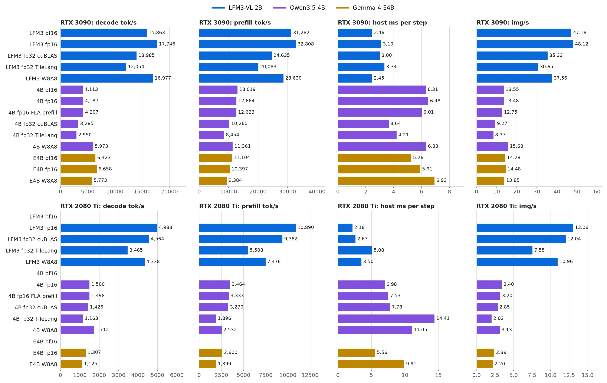

Linux, bf16 checkpoints converted at load, `gdn_prefill` `fused`. Decode: S × 64-token prompts, 512
generated, S 128 on the 3090 and 64 on the 2080 Ti. Prefill: S × 2048-token prompts. Host: ms of the
loop's own work per step. Captions: the same 1024 rows in process. 4B carries the int8 GDN state on
W8A8, W8A8 rotates by 16 ([Turing and Ampere](docs/measurements/turing-ampere.md)):

| Model | Work | 3090 decode tok/s | Prefill tok/s | Host ms | img/s | Slots | 2080 Ti decode tok/s | Prefill tok/s | Host ms | img/s | Slots |
|---|---|---|---|---|---|---|---|---|---|---|---|
| LFM3-VL 2B | bf16 | 15,863 | 31,282 | 2.46 | 47.18 | 256 | | | | | |
| LFM3-VL 2B | fp16 | 17,746 | 32,808 | 3.10 | **48.12** | 256 | 4,983 | 10,890 | 2.18 | **13.06** | 256 |
| LFM3-VL 2B | `fp32`, cuBLAS | 13,985 | 24,635 | 3.00 | 35.33 | 256 | 4,564 | 9,382 | 2.63 | 12.04 | 256 |
| LFM3-VL 2B | `fp32`, TileLang | 12,054 | 20,083 | 3.34 | 30.65 | 256 | 3,465 | 5,508 | 5.08 | 7.55 | 256 |
| LFM3-VL 2B | W8A8 | 16,977 | 28,630 | 2.45 | 37.56 | 256 | 4,338 | 7,476 | 3.50 | 10.96 | 256 |
| Qwen3.5 4B | bf16 | 4,113 | 13,019 | 6.31 | 13.55 | 96 | | | | | |
| Qwen3.5 4B | fp16 | 4,187 | 12,664 | 6.48 | 13.48 | 92 | 1,500 | 3,464 | 6.98 | **3.40** | 79 |
| Qwen3.5 4B | fp16, FLA prefill | 4,207 | 12,623 | 6.01 | 12.75 | 92 | 1,498 | 3,333 | 7.53 | 3.20 | 79 |
| Qwen3.5 4B | `fp32`, cuBLAS | 3,285 | 10,260 | 3.64 | 9.27 | 57 | 1,426 | 3,270 | 7.78 | 2.85 | 47 |
| Qwen3.5 4B | `fp32`, TileLang | 2,950 | 8,454 | 4.21 | 8.37 | 52 | 1,163 | 1,896 | 14.41 | 2.02 | 43 |
| Qwen3.5 4B | W8A8 | 5,973 | 11,361 | 6.33 | **15.68** | 218 | 1,712 | 2,532 | 11.05 | 3.13 | 175 |
| Gemma 4 E4B | bf16 | 6,423 | 11,104 | 5.26 | 14.28 | 132 | | | | | |
| Gemma 4 E4B | fp16 | 6,658 | 10,397 | 5.91 | **14.48** | 120 | 1,307 | 2,600 | 5.56 | **2.39** | 90 |
| Gemma 4 E4B | W8A8 | 5,773 | 9,384 | 6.93 | 13.85 | 181 | 1,125 | 1,899 | 9.91 | 2.20 | 143 |

Logit gaps over 1,024 tokens of real text against a float32 Hugging Face forward, decode at 128 rows
on a 3090:

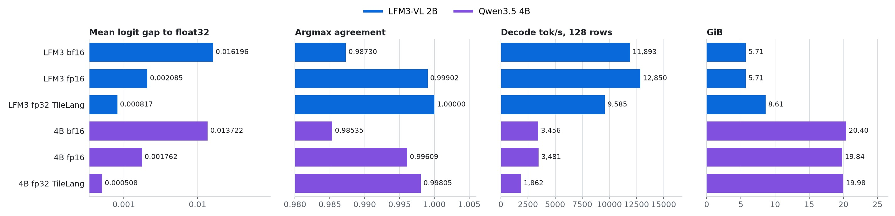

| Model | Work | tok/s | GiB | Argmax | Gap mean |
|---|---|---|---|---|---|
| LFM3-VL 2B | bf16 | 11,893 | 5.71 | 0.98730 | 0.016196 |
| LFM3-VL 2B | fp16 | 12,850 | 5.71 | 0.99902 | 0.002085 |
| LFM3-VL 2B | `fp32`, TileLang | 9,585 | 8.61 | 1.00000 | 0.000817 |
| Qwen3.5 4B | bf16 | 3,456 | 20.40 | 0.98535 | 0.013722 |
| Qwen3.5 4B | fp16 | 3,481 | 19.84 | 0.99609 | 0.001762 |
| Qwen3.5 4B | `fp32`, TileLang | 1,862 | 19.98 | 0.99805 | 0.000508 |

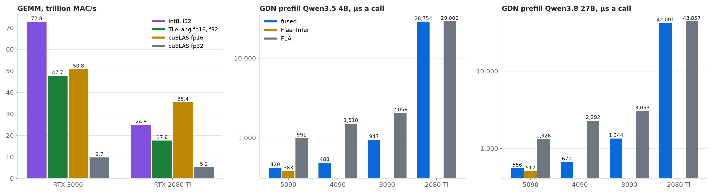

GEMMs at M 256, N 65536, K 2048, in trillion multiply-accumulates per second:

| Card | int8, i32 | TileLang fp16, f32 | cuBLAS fp16 | cuBLAS fp32 |
|---|---|---|---|---|
| RTX 3090 | 72.8 | 47.7 | 50.8 | 9.7 |
| RTX 2080 Ti | 24.9 | 17.6 | 35.4 | 5.2 |

The GDN chunked prefill on our own `fused` kernel against FlashInfer and the vendored FLA, 8 × 1024
tokens, µs a call; FlashInfer needs sm90. On a 5090 a whole prefill holds level: 73,371 against
75,784 tok/s on 4B, 17,300 against 16,999 on 27B.

| Card | Dtype | 4B `fused` | 4B FlashInfer | 4B FLA | 27B `fused` | 27B FlashInfer | 27B FLA |
|---|---|---|---|---|---|---|---|
| RTX 5090 | bf16 | 420 | 383 | 991 | 556 | 512 | 1,326 |
| RTX 4090 | bf16 | 488 | | 1,510 | 670 | | 2,292 |
| RTX 3090 | bf16 | 947 | | 2,056 | 1,344 | | 3,053 |
| RTX 2080 Ti | fp16 | 28,754 | | 29,000 | 42,001 | | 43,857 |

### Windows on an RTX 4090

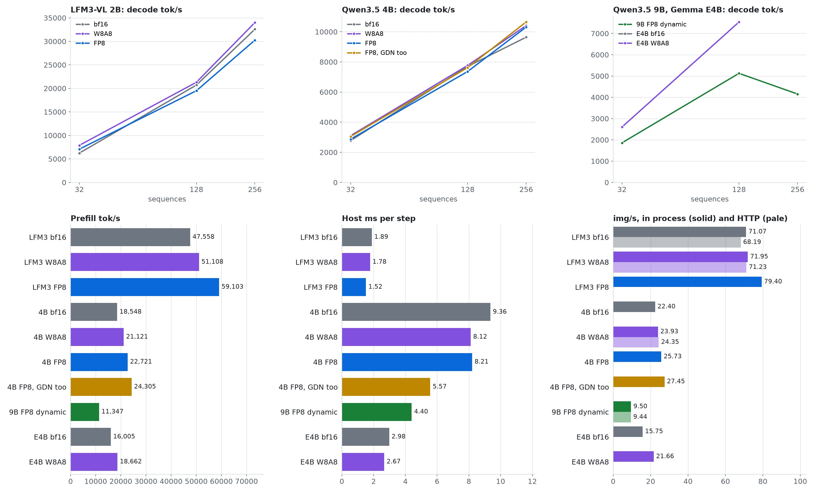

Windows 11, no FlashInfer, every run capped at 19 GiB of the card's 24, `kv_leave` 1.5 GiB,
`kv_reserve` 5 GiB, `head` bf16, `gdn_prefill` `fused`. Decode: S × 64-token prompts, 512 generated.
Prefill: 32 × 2048-token prompts. Host: ms of the loop's own work per step at the largest S.
Captions: the same 1024 rows ([Windows](docs/measurements/windows-4090.md)):

| Model | Linears | Decode tok/s S32 | S128 | S256 | Prefill tok/s | Host ms | img/s in process | img/s HTTP | Slots |
|---|---|---|---|---|---|---|---|---|---|
| LFM3-VL 2B | bf16 | 6,235 | 20,706 | 32,579 | 47,558 | 1.89 | 71.07 | 68.19 | 256 |
| LFM3-VL 2B | W8A8, rotate 16 | 7,887 | 21,297 | 34,011 | 51,108 | 1.78 | 71.95 | 71.23 | 256 |
| LFM3-VL 2B | FP8 | 7,077 | 19,498 | 30,259 | 59,103 | 1.52 | **79.40** | | 256 |
| Qwen3.5 4B | bf16 | 2,777 | 7,699 | 9,642 | 18,548 | 9.36 | 22.40 | | 127 |
| Qwen3.5 4B | W8A8, rotate 16 | 3,105 | 7,769 | 10,415 | 21,121 | 8.12 | 23.93 | 24.35 | 176 |
| Qwen3.5 4B | FP8 | 2,873 | 7,366 | 10,316 | 22,721 | 8.21 | 25.73 | | 135 |
| Qwen3.5 4B | FP8, GDN projections too | 3,049 | 7,626 | 10,656 | 24,305 | 5.57 | **27.45** | | 158 |
| Qwen3.5 9B | FP8 dynamic | 1,860 | 5,126 | 4,155 | 11,347 | 4.40 | 9.50 | 9.44 | 29 |
| Gemma 4 E4B | bf16 | 2,576 | | | 16,005 | 2.98 | 15.75 | | 36 |
| Gemma 4 E4B | W8A8, rotate 16 | 2,602 | 7,539 | | 18,662 | 2.67 | 21.66 | | 105 |

All Qwen rows carry the int8 GDN state. 9B holds 96 rows at S256 in 19 GiB. E4B leaves the cap at
S128 in bf16 and S256 in W8A8; at S64 it decodes 4,696 tok/s in bf16 and 4,495 in W8A8.

## Repository layout

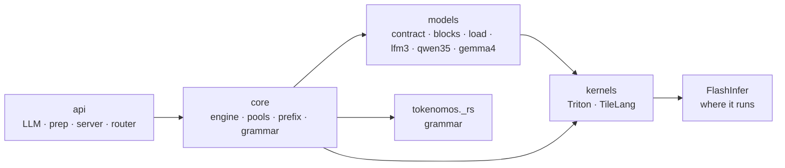

```
src/tokenomos/
  api/            LLM, prep/ (process pool, image ring), the chat template, server, router
  core/           the engine, slot table and pools, staging, prefix table, device grammar, floats
  models/
    contract.py   what a model declares (StateSpec per layer), what the engine hands it (Step)
    blocks/       linear, RMSNorm, RoPE, attention, short conv, Gated DeltaNet, SwiGLU, decoder
    load/         safetensors checkpoints, compressed-tensors and ModelOpt schemes
    lfm3/  qwen35/  gemma4/        declarations, vision encoders, image processors
    reference.py  whole-sequence forward without the engine (tests, parity)
  kernels/
    linear/       skinny 16-bit, FP8, W8A8, fp16 accumulating in float32
    mxfp8/        fused producers writing cuBLAS-swizzled scales; the GEMM routed from tables/
    nvfp4/        producers and the FP4 GEMM, routed over CUTLASS and b12x from tables/
    attention/    paged and ring attention, causal or bidirectional prefill, q/k norm + RoPE
    gdn/          the state pool in four formats, decode step, gated norm, the fused prefill,
                  fla/ (vendored prefill)
    norm/  conv/  sampling/  grammar/  engine/  rounding.py
src/tokenomos-rust/   tokenomos._rs: JSON-schema matcher, mask store, device table entries
bench/            every measurement, each writing to reports/; profile/ (nsys, roofline, tuning)
scripts/docs/     this README's figures
docs/             measurements, assets
tests/            api, core, kernels, models
```

## Documentation

| Where | Read it for |
|---|---|
| [captions](docs/measurements/captions.md) | caption rates, where the time goes, the full GBC graph, what sets the slot count |
| [bottlenecks](docs/measurements/bottlenecks.md) | every frontend stage, side costs per model, card ceilings |
| [LFM3](docs/measurements/lfm3-vl-2b.md), [Qwen](docs/measurements/qwen35.md), [Gemma 4](docs/measurements/gemma4.md) | decode, prefill and faithfulness per family |
| [Turing and Ampere](docs/measurements/turing-ampere.md) | GEMM rates, W8A8 agreement, work dtypes, GBC on the 3090 and 2080 Ti |
| [Windows](docs/measurements/windows-4090.md) | every format on the RTX 4090, FP8 included, the GDN prefill without FlashInfer |
| [grammar](docs/measurements/grammar.md) | the device grammar's cost |

## Checks

```
PYTHONPATH=src TOKENOMOS_MODELS=/path/to/models python -m pytest tests
cargo test
python bench/decode.py --model M --n 256
python bench/caption.py --model M --rows ROWS.jsonl --n 1024 --tap
python bench/suite/run.py --box BOX      # every arm of a box, from bench/suite/boxes.json
python scripts/docs/plots.py docs/assets
```

GPU tests carry the `gpu` marker and skip what the card cannot run (`bf16`, `fp8`, `sm100`). Model
tests need `TOKENOMOS_MODELS`. Kernels hold against float64 references and their vLLM counterparts'
bytes, the engine holds to the dense single-sequence reference, and the tricky paths have their own
checks: arena reuse, the pause path against a roomy pool, streaming against the plain reply,
tile sizes on Turing's shared memory, a server watching its stdin while starting workers.

## Contributing

Open an issue first for a feature. Conventions: black and ruff at line length 100, no imports
inside functions, nested folders, comments that say what the code does, docs that describe what
exists, and every check able to fail on a broken implementation. Run the checks above before a
pull request.

## License

Apache-2.0.
